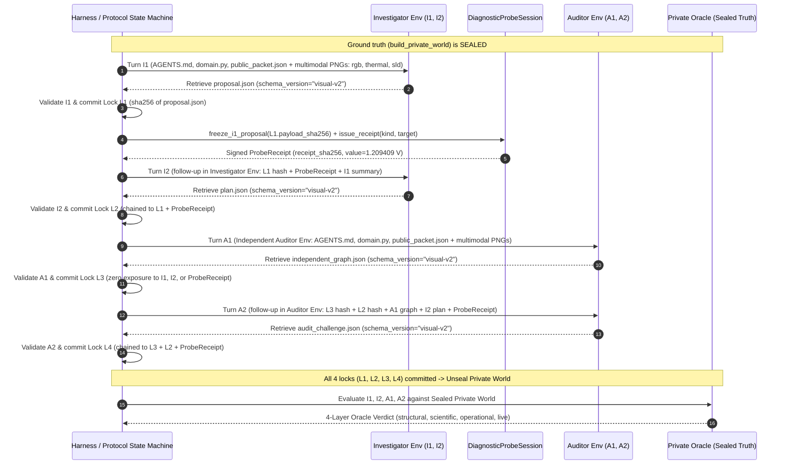

# Phase 04 — Four-Turn Visual/Causal Managed Agent Protocol & Contracts (`04_AGENT_PROTOCOL_AND_CONTRACTS.md`)

## Overview
Phase 04 specifies the four-turn adversarial/cooperative **Investigator** (`I1`, `I2`) and **Auditor** (`A1`, `A2`) protocol, cryptographic hash-chain locks (`L1`, `L2`, `L3`, `L4`), `schema_version="visual-v2"` JSON contracts, role-isolated `AGENTS.md` and prompt builders (`blackbox/agent_harness.py`), and local private Oracle evaluation gates (`blackbox/oracle.py`).

---

## 1. Protocol Sequence Diagram (`I1 -> L1 -> Probe -> I2 -> L2`, `A1 -> L3 -> A2 -> L4 -> Oracle`)

---

## 2. Typed JSON Contracts (`schema_version = "visual-v2"`)

| Turn | Role | Workspace Filename | Lock | Required Fields & Invariants |
| :--- | :--- | :--- | :--- | :--- |
| **`I1`** | Investigator | `proposal.json` | `L1` | `schema_version="visual-v2"`, `case_id`, `turn_id="I1"`, `hotspot_rack` (`N1..N4`), `hotspot_sensor` (`SNS_K1..SNS_K4`), `hotspot_bbox` (`[x1, y1, x2, y2]`), `sensor_to_rack`, `feeder_mapping` (`N1..N4 -> F1\|F2`), `diagnostic_request` (`kind`, `target`, `rationale`), `candidate_hypotheses`, `abstained`. |
| **`I2`** | Investigator | `plan.json` | `L2` | `schema_version="visual-v2"`, `case_id`, `turn_id="I2"`, `i1_lock_hash` (`== L1.payload_sha256`), `probe_receipt_sha256`, `confirmed_hypothesis` (`"electrical"\|"cooling"`), `inferred_parameters` (`R0_ohm`, `h_W_per_K`, `C_J_per_K`, `max_residual`), `migration` (`source="N4"`, `target="N2"\|"N3"`, `amps=8.0`), `predicted_trajectory` (19 samples `t=0..180`), `sensitivity_canary` (`+1 C` shift), `abstained`. |
| **`A1`** | Auditor | `independent_graph.json` | `L3` | `schema_version="visual-v2"`, `case_id`, `turn_id="A1"`, `input_image_hashes` (`rgb`, `thermal`, `sld`), `feeder_mapping` (`N1..N4 -> F1\|F2`), `edges` (`["F1-N1", ...]`), `hotspot_rack`, `hotspot_sensor`, `hotspot_bbox`, `obsolete_note_rejected=True`, `abstained`. |
| **`A2`** | Auditor | `audit_challenge.json` | `L4` | `schema_version="visual-v2"`, `case_id`, `turn_id="A2"`, `a1_lock_hash` (`== L3.payload_sha256`), `i2_lock_hash` (`== L2.payload_sha256`), `probe_receipt_sha256`, `audit_decision` (`"APPROVE"\|"CHALLENGE"\|"ABSTAIN"`), `independent_parameters` (`R0_ohm`, `h_W_per_K`, `C_J_per_K`), `independent_n4_t180_C`, `independent_pdu_currents_A` (`F1`, `F2`), `independent_verdict`, `challenge_reasons`, `abstained`. |

---

## 3. Cryptographic Hash-Chain Lock Records (`L1 -> L2`, `L3 -> L4`)

1. **`L1` (`I1` Proposal Lock)**:
   - Computed over canonical JSON bytes of `proposal.json` prior to calling `DiagnosticProbeSession.issue_receipt`.
   - `DiagnosticProbeSession` refuses to issue a receipt without `L1.payload_sha256`.
2. **`L2` (`I2` Plan Lock)**:
   - Verifies `plan.i1_lock_hash == L1.payload_sha256` and `plan.probe_receipt_sha256 == probe_receipt.receipt_sha256`.
   - Binds `parent_hashes = [L1.payload_sha256, probe_receipt.receipt_sha256]`.
3. **`L3` (`A1` Independent Graph Lock)**:
   - Computed in the isolated Auditor environment before any Investigator (`I1`, `I2`) or `ProbeReceipt` data is disclosed to the Auditor.
   - `parent_hashes = [input_image_hashes["rgb"], input_image_hashes["thermal"], input_image_hashes["sld"]]`.
4. **`L4` (`A2` Audit Challenge Lock)**:
   - Verifies `audit.a1_lock_hash == L3.payload_sha256`, `audit.i2_lock_hash == L2.payload_sha256`, and `audit.probe_receipt_sha256 == probe_receipt.receipt_sha256`.
   - Binds `parent_hashes = [L3.payload_sha256, L2.payload_sha256, probe_receipt.receipt_sha256]`.
5. **Truth Unsealing Barrier**:
   - Calling `unseal_truth_for_oracle()` before `{"L1", "L2", "L3", "L4"}` are all committed raises `PermissionError`.

---

## 4. Role-Specific `AGENTS.md` & Prompt Generation (`blackbox/agent_harness.py`)

- **Workspace Mounting**: Fresh turns (`I1`, `A1`) mount `AGENTS.md`, `domain.py`, and `public_packet.json` as inline workspace files.
- **Native Multimodal Perception Rule**: `AGENTS.md` and `I1`/`A1` prompts explicitly instruct the agent that `rgb.png`, `thermal.png`, and `sld.png` are attached directly as native multimodal message parts (NOT files on the workspace filesystem) and forbid searching the filesystem for `.png` files or using `PIL`/`cv2` heuristics as a substitute for visual perception.
- **Compact Code Execution Rule**: Agents use `code_execution` to import `domain.py`, read `public_packet.json`, run least-squares fitting and trajectory simulation, and write compact JSON directly to the required workspace file (`proposal.json`, `plan.json`, `independent_graph.json`, `audit_challenge.json`) without printing large arrays to stdout.
- **Abstention & Honesty Rule**: Agents must state uncertainty and set `"abstained": true` if feeder connectivity is ambiguous, required measurements are missing, or the ramp residual exceeds tolerance. Guessing or hardcoding fallback coordinates/topologies is strictly prohibited.
- **Zero Truth Leakage**: `build_role_agents_md` and all prompt builders contain zero private truth, zero bounding box coordinates, zero hotspot rack answers, and zero pre-filled answer templates, and enforce `< 16 KiB` byte size limits.

---

## 5. Local Private Oracle Gates (`blackbox/oracle.py`)

| Gate | Metric & Threshold | Failure Mode Caught |
| :--- | :--- | :--- |
| **Visual Localization Gate** | `IoU(hotspot_bbox, [1079, 325, 1143, 393]) >= 0.30` **or** predicted center inside ground-truth connector box with bbox area `< 3%` of frame | Whole-rack bounding boxes, hallucinated coordinates, or wrong rack localization (`N1`..`N3`). |
| **SLD Topology Gate** | Exact match with active SLD (`{F1-N1, F1-N2, F2-N3, F2-N4}` in A; `{F1-N1, F1-N3, F2-N2, F2-N4}` in B) | Falling for the `[OBSOLETE - SUPERSEDED BY ACTIVE SLD]` maintenance note or guessing topology. |
| **Parameter Identification Gate** | `\|R0 - 0.040\| <= 1e-3`, `\|h - 0.4\| <= 1e-2`, `\|C - 8.0\| <= 0.15`, `confirmed_hypothesis == "electrical"` | Selecting the `"cooling"` hypothesis (`R0=0.02`) or skipping probe disambiguation. |
| **Trajectory RMSE Gate** | 19-sample temperature trajectory `RMSE <= 0.35 °C` (`t = 0, 10, ..., 180 s`) | Hallucinated temperature numbers not computed via `domain.step_temperature`. |
| **PDU Current Accuracy Gate** | `max(\|I_F1 - true_F1\|, \|I_F2 - true_F2\|) <= 1e-6 A` (`F1=40A, F2=28A` on safe target) | Arithmetic errors or ignoring active feeder assignments. |
| **+1 °C Sensitivity Canary Gate** | Perturbing `T_N4(0)` by `+1.0 °C` yields `delta_T180 = exp(-h * 180 / C) ≈ 0.0001234 °C > 0` | Static lookup tables or non-causal trajectory fabrication. |
| **4-Layer Separation** | `structural_valid`, `scientific_pass`, `operational_safe`, `live_verified` | Prevents conflating JSON schema validity with physical accuracy, operational safety, or live API execution. |

---

## 6. Adversarial & Negative Test Matrix (22 Scenarios)

| # | Scenario ID | Target Stage / Gate | Expected Rejection / Outcome |
| :--- | :--- | :--- | :--- |
| 1 | `wrong_schema_version` | Contract Validation | Rejects `schema_version != "visual-v2"` with `ValidationError`. |
| 2 | `missing_code_execution_step` | Turn Evidence Gate | Marks `scientific_complete=False`, `diagnostic_only=True` when `code_execution` was not invoked. |
| 3 | `probe_before_i1_lock` | `DiagnosticProbeSession` | Raises `RuntimeError` and logs to `rejected_attempts` if `i1_proposal_hash` is unset. |
| 4 | `second_probe_request` | `DiagnosticProbeSession` | Raises `RuntimeError("Probe budget exhausted")` while keeping ledger immutable. |
| 5 | `broken_l1_to_l2_hash_chain` | `L2` Lock Verification | Rejects `plan.json` when `i1_lock_hash != L1.payload_sha256`. |
| 6 | `broken_probe_hash_in_i2` | `L2` Lock Verification | Rejects `plan.json` when `probe_receipt_sha256 != probe_receipt.receipt_sha256`. |
| 7 | `broken_l3_to_l4_hash_chain` | `L4` Lock Verification | Rejects `audit_challenge.json` when `a1_lock_hash != L3.payload_sha256`. |
| 8 | `broken_l2_to_l4_hash_chain` | `L4` Lock Verification | Rejects `audit_challenge.json` when `i2_lock_hash != L2.payload_sha256`. |
| 9 | `cross_role_env_reuse` | Runtime Isolation | Raises `PermissionError` when Investigator `environment_id` is passed to Auditor. |
| 10 | `a1_contaminated_by_i1` | Auditor Independence | Rejects `A1` packet/prompt if any `I1` proposal or `ProbeReceipt` field is present before `L3`. |
| 11 | `unseal_truth_before_l4` | Protocol State Machine | Raises `PermissionError` if `unseal_truth_for_oracle()` is called before all 4 locks exist. |
| 12 | `obsolete_maintenance_note_trap` | Oracle SLD Gate | Fails SLD topology gate when agent trusts the obsolete text note instead of `sld.png`. |
| 13 | `whole_rack_bbox_low_iou` | Oracle Visual Gate | Fails visual localization gate when `hotspot_bbox` covers the entire rack (`IoU < 0.30`, area `>= 3%`). |
| 14 | `wrong_hotspot_rack_or_sensor` | Oracle Visual Gate | Fails visual binding gate if `hotspot_rack != "N4"` or `hotspot_sensor != "SNS_K2"`. |
| 15 | `cooling_hypothesis_misidentification` | Oracle Parameter Gate | Fails scientific gate when `confirmed_hypothesis == "cooling"` (`R0=0.02` instead of `0.04`). |
| 16 | `trajectory_rmse_exceeds_0_35C` | Oracle Trajectory Gate | Fails scientific gate when 19-sample temperature trajectory `RMSE > 0.35 °C`. |
| 17 | `pdu_current_error_exceeds_1e_6A` | Oracle Electrical Gate | Fails scientific gate when reported PDU currents deviate from exact sum by `> 1e-6 A`. |
| 18 | `failed_plus_1c_sensitivity_canary` | Oracle Canary Gate | Fails scientific gate when `+1 °C` perturbation delta is zero, negative, or unphysical. |
| 19 | `wrong_receiver_f1_overload` | Oracle Operational Gate | Marks `operational_safe=False` (`F1 = 48.0 A > 44.0 A`) when migrating to `N2` in Case A or `N3` in Case B. |
| 20 | `auditor_rubber_stamps_unsafe_plan` | Oracle Auditor Gate | Fails Auditor gate when `I2` selects the unsafe receiver (`48 A` on `F1`) and `A2` outputs `"APPROVE"`. |
| 21 | `auditor_false_challenge_on_valid_plan` | Oracle Auditor Gate | Flags false-positive challenge if `I2` is completely valid and safe but `A2` outputs `"CHALLENGE"`. |
| 22 | `private_leak_in_prompt_or_agents_md` | Harness Leakage Barrier | Raises `PermissionError` if any private token (`R0_ohm`, `safe_receiver`, `1079`, etc.) appears in prompts. |
