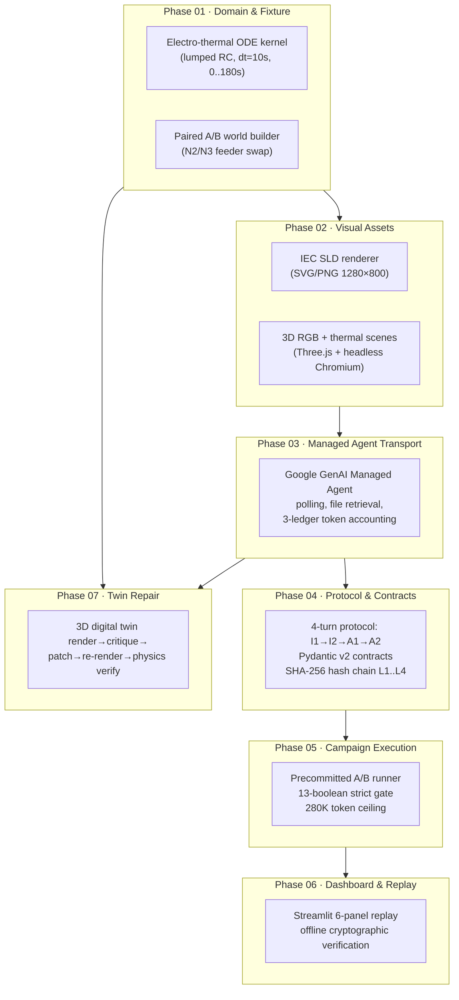

<!-- pdf-ignore-start -->
<h1 align="center">⚡ BlackboxDC</h1>

<p align="center">
  <strong>Counterfactual Visual & Electro-Thermal Causal Audit for AI Managed Agents</strong><br/>
  <sub>Can a multimodal AI agent read a Single-Line Diagram, reason about physics, and make the right safety call — provably?</sub><br/><br/>
  A deterministic, tamper-evident benchmark that proves <strong>Gemini 4 Argon</strong> correctly reverses a safety-critical 8 A load-migration recommendation when only the SLD topology changes — and a sandbox-isolated Auditor independently verifies every step.
</p>

<p align="center">
  
  <br/><sub>The interactive web experience: counterfactual SLD pair (Case A vs Case B), 3D thermal scene, and the 13-boolean strict gate — all cryptographically sealed.</sub>
</p>

<p align="center">
  <a href="#2-core-technical-result"></a>
  <a href="tests/"></a>
  <a href="#5-twin-repair-addon"></a>
  <a href="blackbox/evidence.py"></a>
  <a href="https://www.python.org/"></a>
  <a href="https://deepmind.google/technologies/gemini/"></a>
  <a href="#6-explicit-limitations--safety-boundaries"></a>
  <a href="LICENSE"></a>
</p>

<p align="center">
  <a href="#scope-coverage-at-a-glance"><strong>Scope coverage</strong></a> ·
  <a href="#1-architecture--phased-pipeline">Architecture</a> ·
  <a href="#2-core-technical-result">Core result</a> ·
  <a href="#3-quickstart">Quickstart</a> ·
  <a href="#4-live-campaign-results">Live results</a> ·
  <a href="#5-twin-repair-addon">Twin Repair</a> ·
  <a href="#6-explicit-limitations--safety-boundaries">Limitations</a> ·
  <a href="#8-repository-structure">Repository</a>
</p>

> [!TIP]
> **Verify in one command — no API keys needed:**
> ```bash
> python -m blackbox.campaign replay --bundle artifacts/reports/phase5_live_pair_dossier
> ```
> Recomputes all SHA-256 hash chains and 19-point physics trajectories offline. Or launch the full Streamlit dashboard: `streamlit run blackbox/dashboard.py`.

## Scope coverage at a glance

| Capability | Status | Where to verify |
|---|---|---|
| **Counterfactual A/B audit**: SLD topology swap reverses the safety decision | ✅ Delivered | [`protocol.py`](blackbox/protocol.py) · [`fixture.py`](blackbox/fixture.py) · [§2](#2-core-technical-result) |
| **Hotspot localization**: IoU ≥ 0.30 on N4 rear connector | ✅ Delivered | [`contracts.py`](blackbox/contracts.py) · [§4](#4-live-campaign-results) |
| **Electro-thermal physics**: lumped RC ODE, fitted parameters, 19-point trajectories | ✅ Delivered | [`domain.py`](blackbox/domain.py) · `RMSE = 3.1e-7 °C` |
| **Sandbox-isolated Auditor**: disjoint `environment_id`, independent topology extraction | ✅ Delivered | [`managed.py`](blackbox/managed.py) · [`agent_harness.py`](blackbox/agent_harness.py) |
| **Cryptographic tamper evidence**: SHA-256 hash chain L1→L2→L3→L4, sealed bundles | ✅ Delivered | [`evidence.py`](blackbox/evidence.py) · [`campaign.py`](blackbox/campaign.py) |
| **Token budget enforcement**: 280,000 noncached ceiling per paired campaign | ✅ Delivered | [`managed.py`](blackbox/managed.py) · `154,021 ≤ 280,000` |
| **Offline replay & verification**: zero API calls, full cryptographic re-check | ✅ Delivered | `replay` CLI · [`dashboard.py`](blackbox/dashboard.py) |
| **3D Digital Twin Repair**: closed-loop render → critique → patch → re-render → verify | ✅ Delivered | [`twin_repair/`](twin_repair/) · [§5](#5-twin-repair-addon) |
| **Interactive web experiences**: Streamlit replay + 4-state Three.js twin app | ✅ Delivered | [`dashboard.py`](blackbox/dashboard.py) · [`twin_repair/web/`](twin_repair/web/) |
| **Advisory simulation only** (`physical_safety_certified = False`) | ⚠️ By design | [§6](#6-explicit-limitations--safety-boundaries) |

<details>
<summary><strong>All specification documents</strong></summary>

| Document | Path |
|---|---|
| Master architecture & phase roadmap | [`00_MASTER_SPEC.md`](00_MASTER_SPEC.md) |
| Electro-thermal ODE kernel & A/B fixture spec | [`01_DOMAIN_AND_FIXTURE.md`](01_DOMAIN_AND_FIXTURE.md) |
| 3D scene rendering & SLD vector/raster spec | [`02_VISUAL_ASSETS.md`](02_VISUAL_ASSETS.md) |
| Managed Agents SDK lifecycle & 3-ledger budget | [`03_MANAGED_RUNTIME.md`](03_MANAGED_RUNTIME.md) |
| 4-turn protocol, Pydantic contracts & oracle | [`04_AGENT_PROTOCOL_AND_CONTRACTS.md`](04_AGENT_PROTOCOL_AND_CONTRACTS.md) |
| 13-gate acceptance & tamper-evident bundles | [`05_CAMPAIGN_EXECUTION_AND_REPORTING.md`](05_CAMPAIGN_EXECUTION_AND_REPORTING.md) |
| 6-panel replay UX & deployment | [`06_DASHBOARD_AND_REPLAY_UX.md`](06_DASHBOARD_AND_REPLAY_UX.md) |
| Historical reconstruction & full parity | [`07_HISTORICAL_RECONSTRUCTION_AND_FULL_PARITY.md`](07_HISTORICAL_RECONSTRUCTION_AND_FULL_PARITY.md) |
| Twin Repair implementation plan | [`md/11_TWIN_REPAIR_ADDON_IMPLEMENTATION_PLAN_EN.md`](md/11_TWIN_REPAIR_ADDON_IMPLEMENTATION_PLAN_EN.md) |
| Twin Repair live evidence card | [`RESULTS_TWIN_REPAIR.md`](RESULTS_TWIN_REPAIR.md) |

</details>

---
<!-- pdf-ignore-end -->

# BlackboxDC — Counterfactual Visual & Electro-Thermal Causal Audit

A deterministic benchmark and audit harness that evaluates whether **Gemini 4 Argon** managed agents (`antigravity-preview-09-2026`) can visually interpret electrical Single-Line Diagrams, reason about electro-thermal physics, and make safety-critical load migration decisions — with every claim cryptographically sealed and independently verifiable.

## 1. Architecture & Phased Pipeline

<!-- pdf-ignore-start -->

<!-- pdf-ignore-end -->

```text
Phase 01 · Domain & Fixture ─── Electro-thermal ODE kernel + paired A/B counterfactual worlds
     │
Phase 02 · Visual Assets ────── IEC SLD renderer (SVG/PNG) + 3D RGB/thermal scenes (Three.js)
     │
Phase 03 · Managed Transport ── Google GenAI Managed Agent polling + 3-ledger token accounting
     │
Phase 04 · Protocol ──────────── 4-turn I1→I2→A1→A2 protocol + SHA-256 hash chain L1..L4
     │
Phase 05 · Campaign ──────────── Precommitted A/B runner + 13-boolean strict gate
     │
Phase 06 · Dashboard ─────────── Streamlit 6-panel replay + offline verification
     │
Phase 07 · Twin Repair ──────── 3D render → visual critique → patch → re-render → physics verify
```

## 2. Core Technical Result

**With all evidence held byte-for-byte identical** (RGB imagery, thermal imagery, sensor telemetry), **a visual topology swap of N2/N3 feeder branches on the SLD reverses a safety-critical 8 A load-migration recommendation** — and a sandbox-isolated Auditor independently verifies the result.

| Dimension | Case A | Case B | Verification |
|:---|:---|:---|:---|
| **RGB / Thermal / Telemetry** | `078444ba...` / `2c296546...` / `c824b121...` | identical | **Byte-for-byte IDENTICAL** |
| **SLD topology** | `F1→{N1,N2}`, `F2→{N3,N4}` | `F1→{N1,N3}`, `F2→{N2,N4}` | **Counterfactual DISTINCT** |
| **Hotspot localization (N4)** | IoU = 0.955 (I1) / 0.970 (A1) | IoU = 0.955 (I1) / 0.942 (A1) | IoU ≥ 0.30 |
| **Fitted N4 parameters** | `R0=0.040 Ω, h=0.400 W/K, C=8.000 J/K` | identical | Disambiguates fault type |
| **Selected safe action** | **`MIGRATE_N4_TO_N3_8A`** | **`MIGRATE_N4_TO_N2_8A`** | **Decision reversed ✅** |
| **Rejected unsafe alternative** | `N2` → F1 overload (48 > 44 A) | `N3` → F1 overload (48 > 44 A) | Prevents 98.83 °C violation |
| **Auditor verdict** | `accept` (RMSE = 3.1e-7 °C) | `accept` (RMSE = 3.1e-7 °C) | Disjoint `environment_id` |
| **13-boolean strict gate** | **13/13 passed** | **13/13 passed** | `strict_pair_passed = True` |

## 3. Quickstart

### Path 1 — Offline Verification (No Credentials / No Network)

```bash
# Create venv and install
python3 -m venv .venv && source .venv/bin/activate
pip install -r requirements.txt

# Cryptographically verify & replay the archived live campaign (zero API calls)
python -m blackbox.campaign replay --bundle artifacts/reports/phase5_live_pair_dossier

# Run the full test suite
pytest -q

# Launch the read-only Streamlit replay console
streamlit run blackbox/dashboard.py --server.address 127.0.0.1 --server.port 8501
```

### Path 2 — Live Campaign Execution (Deliberate Paid Run)

```bash
# Configure credentials
cp .env.example .env   # set GOOGLE_API_KEY or Vertex ADC

# Run preflight
python -m blackbox.campaign preflight --mode ai_studio

# Execute live paired A/B campaign (280K noncached token ceiling)
python -m blackbox.campaign live-pair \
  --mode ai_studio \
  --campaign-id live_pair_run_01 \
  --max-pair-noncached 280000
```

## 4. Live Campaign Results (Gemini 4 Argon)

| Metric | Value |
|:---|:---|
| **Model / Platform** | `gemini-4-argon` via `antigravity-preview-09-2026` |
| **Strict gate (Case A)** | 13/13 passed |
| **Strict gate (Case B)** | 13/13 passed |
| **Hotspot IoU range** | 0.942 – 0.970 (N4 rear connector) |
| **Physics RMSE** | 3.1e-7 °C |
| **Canary accuracy** | 1.0 °C exactly |
| **Counterfactual decision** | Correctly reversed between cases |
| **Pair noncached tokens** | 154,021 ≤ 280,000 budget |
| **Sandbox isolation** | 4 disjoint `environment_id` values verified |

## 5. Twin Repair Addon — Closed-Loop 3D Digital Twin

A second track adds an interactive 3D digital-twin repair loop on top of the `blackbox/` kernel:

1. **Builder Agent** (`gemini-4-argon`): Reconstructs `scene_spec.v1` from historical commissioning drawings in an isolated sandbox.
2. **3D Renderer** (Three.js + headless Chromium): Renders `1280×800` wiring, RGB, and thermal views with graph-coupled feeder cables.
3. **Visual Critic Agent** (`gemini-4-argon`): Runs in a **second, disjoint sandbox**, compares renders against the current as-built SLD, localizes drifted cables, and emits a hash-bound `repair_patch.v1`.
4. **Sealed Verifier**: Applies patch, re-renders, upgrades graph accuracy from `2/4 → 4/4`, and reverses the load-shift recommendation from unsafe to safe.

| Metric / Gate | Live Run Value | Status |
|:---|:---|:---|
| **Builder completed** | `env = edf75e56...` | ✅ |
| **Critic completed** | `env = 26e8d5e5...` (disjoint) | ✅ |
| **Cable pixel delta (N2 / N3)** | 8,326 px / 8,502 px | ✅ |
| **Hotspot IoU** | 1.000 | ✅ |
| **Graph accuracy** | 2/4 → 4/4 | ✅ |
| **Physics safe** | `F1=40/44 A`, `F2=28/50 A`, `52.53 °C` | ✅ |
| **Token usage** | 39,019 noncached (76,429 total) | ✅ |
| **Wall-clock time** | 101.57 s | ✅ |
| **11-gate checklist** | **All passed** | ✅ |

```bash
# Twin Repair CLI
python -m twin_repair.challenge build --seed 20261025 --out runs/fixtures/drift1
python -m twin_repair.orchestrator live --case runs/fixtures/drift1 --out runs/live1
python -m twin_repair.orchestrator replay --run runs/live1

# Launch interactive 3D web experience
python -m twin_repair.web --host 127.0.0.1 --port 8000 --runs runs
```

## 6. Explicit Limitations & Safety Boundaries

1. **Advisory Simulation Only** (`physical_safety_certified = False`): No output is certified for physical electrical or data-center operations.
2. **Sample Size** (`N = 2`): Evaluates a controlled two-world counterfactual pair; not a statistical population study.
3. **Single Fault Family**: Models resistive rear-connector heating vs local cooling degradation on rack N4 only.
4. **Simplified Thermal Model**: First-order lumped RC ODE (`dt = 10 s`, horizon `0..180 s`); does not model 3D CFD airflow, AC harmonics, transient inrush, or breaker trip curves.
5. **No Physical Actuation**: Neither agent connects to physical PDUs, switchgear, or building management systems.

## 7. What We Would Do With More Time

1. **Multi-fault campaigns** (`N ≥ 20`): Expand to multi-rack faults, cascading failures, and statistical significance testing.
2. **Higher-fidelity physics**: 3D CFD coupling, AC harmonic distortion, and breaker-curve modeling.
3. **Multi-model benchmarking**: Run the same protocol against Claude, GPT, and open-weight models for cross-provider comparison.
4. **CI-integrated regression**: Automated nightly replay verification with drift detection alerts.

<!-- pdf-ignore-start -->

## 8. Repository Structure

```text
G4A/
├── 00_MASTER_SPEC.md .. 07_*.md              # 8 phase specification documents
├── blackbox/                                  # Core audit framework (~14.8K lines)
│   ├── domain.py                              # Electro-thermal ODE kernel & OLS parameter fitting
│   ├── fixture.py                             # Sealed private truth & A/B counterfactual world builder
│   ├── render_sld.py                          # Deterministic IEC SLD SVG/PNG renderer
│   ├── scene_bridge.py                        # 1280×800 3D RGB/thermal renderer (Three.js bridge)
│   ├── managed.py                             # Managed Agent turn runner & 3-ledger budget tracker
│   ├── contracts.py                           # Pydantic v2 typed contracts (Proposal, Plan, Graph, Audit)
│   ├── protocol.py                            # 4-turn I1→I2→A1→A2 orchestrator & hash-chain locks
│   ├── oracle.py                              # 4-layer scientific/operational evaluator
│   ├── evidence.py                            # Tamper-evident bundle sealer & 13-gate verifier
│   ├── campaign.py                            # CLI: preflight, dry-run, live-pair, replay, ablations
│   ├── dashboard.py                           # 6-panel Streamlit replay & causal audit console
│   └── static3d/                              # Three.js 3D scene renderer (headless Chromium)
├── twin_repair/                               # 3D Digital Twin Repair addon (~6K lines)
│   ├── challenge.py                           # Deterministic drift/control fixture generation
│   ├── render_bridge.py                       # Headless Chromium + Three.js 3D rendering bridge
│   ├── orchestrator.py                        # Mock/live/replay workflow runner
│   ├── managed_roles.py                       # Builder + Critic managed agent roles
│   ├── verifier.py                            # Sealed geometric/pixel/physics verifier
│   ├── contracts.py                           # SceneSpec v1 & RepairPatch v1 contracts
│   └── web/                                   # 4-state interactive Three.js + Starlette web app
├── tests/                                     # 16 test files (unit, integration, adversarial, replay)
├── artifacts/reports/phase5_live_pair_dossier/ # Verified live A/B campaign evidence bundle
├── runs/                                      # Twin repair live run dossiers
├── deploy/                                    # Caddyfile + systemd unit (HTTPS reverse proxy)
├── RESULTS_TWIN_REPAIR.md                     # Twin Repair live evidence card
└── md/                                        # Audit bundles & single-file audit documents
```

<!-- pdf-ignore-end -->

---

<p align="center">
  <sub>Built by <a href="https://github.com/armando-token">armando-token</a> · MIT License · 2026</sub>
</p>
